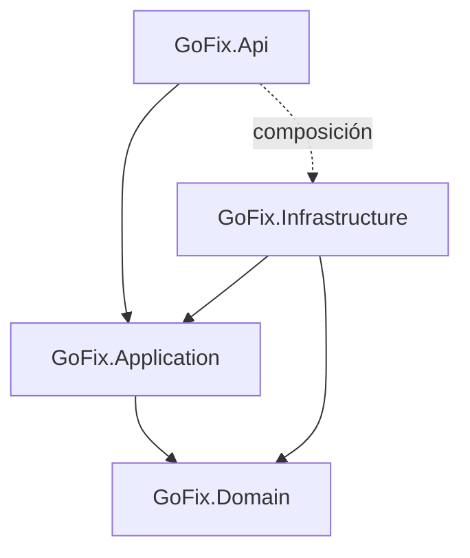
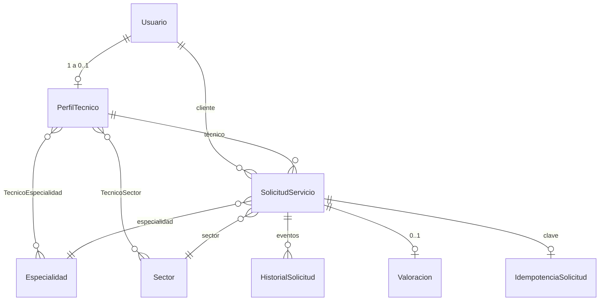

# GoFix · Documento de arquitectura y diseño
 
*Diseño técnico, límites modulares, persistencia, seguridad, contratos HTTP y estrategia de verificación de la primera versión.*
 
| Control documental | Definición |
|---|---|
| Código | GF-ARQ-001 |
| Versión y estado | 1.0 · Revisión editorial 1 (reorganización sin cambio de reglas) · Línea base propuesta para revisión |
| Fecha | 19 de noviembre de 2026 |
| Producto | Plataforma web de conexión entre clientes y técnicos |
| Tecnología acordada | React + TypeScript · ASP.NET Core · SQL Server |
| Arquitectura acordada | Monolito modular · Clean Architecture pragmática |
| Principios acordados | SOLID · YAGNI · DRY |
 
> Las metas, límites y políticas identificados como propuestos requieren validación del responsable del producto. Este documento describe el diseño esperado y no acredita una implementación existente.
 
## 1. Objetivos y restricciones arquitectónicas
 
GoFix se construirá como monolito modular con Clean Architecture pragmática. React presenta la experiencia web y consume una API ASP.NET Core. El backend concentra autorización, reglas y transacciones. SQL Server conserva datos de identidad y negocio en `GoFixDB`. La organización debe permitir seguir un caso de uso de extremo a extremo y verificar su comportamiento sin depender del navegador.
 
### 1.1 Decisiones expresas y propuestas
 
- **Decisiones expresas del solicitante:** React, SQL Server, monolito modular, Clean Architecture pragmática, SOLID, YAGNI y DRY.
- **Propuesta técnica de implementación:** .NET 10 y EF Core 10 con parches compatibles fijados al crear el repositorio. React, TypeScript y Vite se fijan mediante `package.json` y archivo de bloqueo.
### 1.2 Atributos de calidad
 
| Atributo | Decisión que lo favorece |
|---|---|
| Mantenibilidad | Módulos de negocio identificables y dependencias hacia Domain/Application. |
| Integridad | Restricciones SQL, transacciones, control de concurrencia y claves idempotentes. |
| Seguridad | Identity, cookies protegidas, antifalsificación y autorización por recurso. |
| Reproducibilidad | Migraciones por código, configuración externa y compilación documentada. |
| Usabilidad | Pantallas por rol, estado visible, validación y navegación adaptable. |
 
Las metas cuantitativas se encuentran en RNF-01 a RNF-12 del SRS. Son objetivos propuestos sujetos al entorno de pruebas. La arquitectura documentada aún debe comprobarse mediante implementación, pruebas y observación del piloto.
 
## 2. Contexto, componentes y despliegue
 
### 2.1 Componentes
 
| Componente | Responsabilidad y conexión |
|---|---|
| Navegador | Ejecuta React. Consume HTTPS `/api/v1` con JSON, cookie de sesión y token antifalsificación. |
| `GoFix.Api` | Sirve la API y, en el despliegue propuesto, los archivos compilados de React. Orquesta autenticación y middleware. |
| Application y Domain | Ejecutan casos de uso y reglas dentro del mismo proceso backend. |
| Infrastructure | Implementa identidad, repositorios y consultas usando EF Core. |
| SQL Server / `GoFixDB` | Almacena entidades, restricciones, historial y claves idempotentes. Solo el backend accede a la base durante la operación normal. |
 
### 2.2 Topología propuesta
 
Cliente (navegador con React) → HTTPS → Servidor (ASP.NET Core con frontend compilado y API) → conexión SQL cifrada → Persistencia (SQL Server). El backend se publica como una unidad. SQL Server se administra como dependencia independiente. Los módulos comparten proceso y no requieren comunicación de red interna.
 
| Entorno | Comportamiento |
|---|---|
| Desarrollo | Vite sirve React y configura un proxy de `/api` al backend HTTPS. |
| Despliegue de referencia | Frontend y API comparten origen, lo que simplifica cookies y protección antifalsificación. El fallback de rutas SPA se aplica fuera de `/api` y de las rutas de diagnóstico para conservar los códigos HTTP de la API. |
 
## 3. Estructura de la solución
 
### 3.1 Capas y dependencias
 
<!-- fig:capas -->

 
*Figura 1. Las flechas representan referencias de proyecto. La referencia Api → Infrastructure se concentra en la composición de dependencias.*
 
| Proyecto | Contenido y referencias permitidas |
|---|---|
| `GoFix.Domain` | Entidades, estados e invariantes por módulo. Referencia únicamente bibliotecas base del lenguaje. |
| `GoFix.Application` | Casos de uso, DTOs y contratos de persistencia, identidad, reloj y consultas. Referencia Domain. |
| `GoFix.Infrastructure` | `GoFixDbContext`, Identity, migraciones, configuraciones y adaptadores. Referencia Application y Domain. |
| `GoFix.Api` | Endpoints, autenticación HTTP, errores, OpenAPI y composición. Referencia Application e Infrastructure para registrar implementaciones. |
| `frontend` | React, rutas, pantallas, estado y cliente HTTP. Consume contratos JSON. |
| `tests` | Pruebas unitarias, integración y recorrido web según el riesgo. |
 
**Reglas de dependencia.**
 
- La dirección del núcleo es Application → Domain e Infrastructure → Application/Domain.
- Api conoce Infrastructure solo en la raíz de composición. Los endpoints usan casos de uso, sin consultas directas al contexto.
- Domain permanece independiente de EF Core, Identity y ASP.NET Core.
- Las entidades de usuario de Identity se ubican en Infrastructure y se relacionan mediante identificadores con el negocio.
### 3.2 Organización interna
 
Dentro de Domain, Application e Infrastructure se agrupan archivos por Identidad, Profesionales, Servicios y Valoraciones. Application organiza cada operación en una carpeta explícita, por ejemplo `Servicios/AceptarSolicitud`, que contiene entrada, resultado y caso de uso. Se emplean clases inyectadas por constructor con métodos asíncronos. La capa Api convierte DTOs HTTP a las entradas correspondientes.
 
### 3.3 Límites entre módulos y su comprobación
 
Un módulo modifica sus entidades mediante sus casos de uso y repositorios. Las consultas entre módulos usan contratos de Application que devuelven datos mínimos. Por ejemplo, Servicios obtiene una ficha de cobertura desde `IConsultaProfesionales`, y Valoraciones consulta elegibilidad desde `IConsultaServicios`. No se exponen `DbSet` ni `IQueryable` en estos contratos.
 
Al usar proyectos compartidos por capa, los límites entre módulos son convencionales. Se comprobarán con revisión y pruebas de dependencias por espacios de nombres. Un `DbContext` compartido facilita transacciones, pero amplía el acceso técnico a datos. Si crece el equipo y aparecen incumplimientos frecuentes, se evaluará extraer proyectos por módulo sin cambiar las reglas del producto.
 
## 4. Módulos y colaboración
 
### 4.1 Módulos
 
| Módulo | Datos propios | Contratos principales |
|---|---|---|
| Identidad | Cuenta, roles y datos de acceso. | `IServicioIdentidad`, `IUsuarioActual`. Registro, sesión y edición de cuenta. |
| Profesionales | Perfil, especialidades, sectores y asociaciones. | `IConsultaProfesionales`. Devuelve publicación, cobertura y ficha pública. |
| Servicios | Solicitud, eventos e idempotencia de creación. | `IRepositorioSolicitudes`, `IConsultaServicios`. Controla ciclo de vida y elegibilidad para valorar. |
| Valoraciones | Puntuación y comentario asociados al servicio. | `IConsultaValoraciones`. Devuelve promedio, cantidad y opiniones públicas. |
 
### 4.2 Casos de uso representativos
 
- **`CrearSolicitud`.** Valida cliente, consulta cobertura, construye la entidad pendiente y registra el evento inicial.
- **`RegistrarValoracion`.** Consulta servicio, cliente y estado, y crea la opinión protegida por índice único.
- **Perfil público.** Un caso de lectura combina la ficha profesional y la consulta de reputación. El promedio se calcula sobre las opiniones almacenadas, evitando mantener un acumulado que pueda desincronizarse.
### 4.3 Agregados y reglas
 
`SolicitudServicio` es el agregado principal. Expone los métodos `EditarPendiente`, `Aceptar`, `Rechazar`, `Cancelar`, `Iniciar` y `Completar`. Cada método verifica el estado actual y actualiza los datos del evento correspondiente. Application controla identidad y propiedad, y coordina el guardado de la entidad y su historial. `PerfilTecnico` y `Valoracion` poseen sus propias validaciones de contenido y rango.
 
El registro de una cuenta técnica coordina Identity y el perfil usando el mismo contexto y una transacción explícita, dado que `UserManager` puede efectuar varios guardados. La transacción confirma únicamente si la cuenta, el rol y el perfil quedan consistentes. La disponibilidad de roles se prepara mediante inicialización idempotente controlada.
 
## 5. Modelo de datos
 
### 5.1 Relaciones principales
 
<!-- fig:er -->

 
*Figura 2. Relaciones principales. Las relaciones N:M usan tablas intermedias. La solicitud también referencia una especialidad y un sector. Ver observación ARQ-H1 sobre el identificador del técnico.*
 
### 5.2 Tablas y restricciones
 
| Tabla / entidad | Campos y restricciones relevantes |
|---|---|
| Identidad / `AspNetUsers` | Id GUID, nombre hasta 100, correo normalizado único y teléfono. Tablas estándar de Identity para roles y relaciones. |
| `PerfilTecnico` | Id GUID, `UsuarioId` único y FK, `Descripcion` nvarchar(1000), `RowVersion` rowversion. Publicación derivada de completitud. |
| `Especialidad` | Id int, `Nombre` nvarchar(100), `Activa` bit. Nombre único. |
| `Sector` | Id int, `Nombre` nvarchar(100), `Municipio` nvarchar(100), `Activo` bit. Único por municipio y nombre. |
| `TecnicoEspecialidad` | PK compuesta `PerfilTecnicoId` + `EspecialidadId` y sus FK. |
| `TecnicoSector` | PK compuesta `PerfilTecnicoId` + `SectorId` y sus FK. |
| `SolicitudServicio` | Id GUID, `ClienteId`, `TecnicoId`, `EspecialidadId`, `SectorId`, título, descripción y dirección. Estado, fechas preferida y confirmada, inicio y fin, y aceptación UTC. `IsDeleted` y `DeletedAtUtc`. `RowVersion`. |
| `HistorialSolicitud` | Id bigint, `SolicitudId`, `ActorId`, tipo de evento, estado previo y nuevo opcionales, `CreatedAtUtc` y observación. Registra creación, edición, transición y eliminación. |
| `Valoracion` | Id GUID, `SolicitudId` único, `ClienteId`, `TecnicoId`, `Puntuacion` tinyint con CHECK 1..5, `Comentario` nvarchar(1000), `CreatedAtUtc`. |
| `IdempotenciaSolicitud` | `ClienteId` + `Clave` UUID como PK, hash canónico del contenido y `SolicitudId` único. Creación y clave se guardan en la misma transacción. |
 
Una cuenta técnica tiene un perfil. Un técnico posee múltiples especialidades y sectores mediante tablas intermedias. Cada solicitud pertenece a un cliente y un técnico, y contiene una especialidad y un sector. Una solicitud conserva múltiples eventos y, al completarse, admite como máximo una valoración.
 
### 5.3 Configuración y consultas
 
- Las configuraciones Fluent API se separan por módulo. Se usan los esquemas `identity`, `professionals`, `services` y `reviews`, con una única historia de migraciones.
- Las relaciones cruzadas se restringen con `DeleteBehavior.Restrict` para impedir cascadas accidentales.
- La eliminación pendiente establece `IsDeleted` y guarda el evento técnico. Las consultas operativas excluyen eliminadas de forma consistente.
- Los identificadores de Identity se comparten como GUID. Las claves foráneas aseguran existencia, mientras la regla que exige rol cliente o técnico se valida en Application.
- Los eventos de auditoría guardan metadatos y motivo, evitando duplicar teléfonos, direcciones o descripciones completas.
- El borrado lógico implica retención y no equivale a supresión de datos personales. La política de retención para operación pública queda pendiente de definición.
**Índices propuestos.**
 
| Tabla | Índice |
|---|---|
| `SolicitudServicio` | `ClienteId` + `CreatedAtUtc` + `Id` |
| `SolicitudServicio` | `TecnicoId` + `Estado` + `CreatedAtUtc` + `Id` |
| Asociaciones | Índices inversos por especialidad y sector |
| `Valoracion` | `TecnicoId` + `CreatedAtUtc` |
 
Las consultas de listado proyectan DTOs con `AsNoTracking` y paginación en SQL. Los índices se validarán con planes y medición del escenario RNF-04.
 
## 6. Consistencia, concurrencia e idempotencia
 
### 6.1 Transacciones
 
Cada petición usa un contexto *scoped*. Una transición carga la solicitud con su versión, valida permisos y estado, invoca el dominio y añade historial antes del mismo `SaveChanges`. El guardado relacional confirma ambos cambios de forma atómica. Las operaciones que requieren varios guardados, como el registro con Identity, usan una transacción explícita.
 
### 6.2 Control de concurrencia
 
SQL Server genera `RowVersion` para solicitudes y perfiles. La API lo representa en base64 y lo exige al modificar, eliminar o cambiar estado. Si EF Core detecta una versión distinta, se revierte la operación y se responde 409. React muestra el conflicto y recarga tras informar al usuario. Una mutación con conflicto requiere una decisión nueva sobre la versión actual.
 
**Escenario de carrera.** Si cliente y técnico leen la versión V1, uno cancela y el otro acepta. El primer commit cambia la versión a V2. El segundo guardado incluye V1 en la condición y falla con conflicto. El estado e historial del ganador permanecen juntos. Esta prueba debe ejecutarse sobre SQL Server para comprobar el mecanismo real.
 
### 6.3 Idempotencia de la creación
 
1. React genera una clave UUID por intención de crear y la conserva mientras no cambie el contenido.
2. `POST /solicitudes` envía el encabezado `Idempotency-Key`.
3. El backend consulta la combinación cliente-clave y compara el hash canónico. Una coincidencia devuelve el recurso original. Un contenido distinto devuelve 409.
4. En la primera ejecución inserta solicitud, historial y clave en una transacción.
5. La PK compuesta arbitra dos ejecuciones simultáneas. Tras una colisión se revierte, se consulta con un contexto limpio y se devuelve el resultado previo.
 
Las claves se conservan junto con la solicitud en el piloto, incluso si esta se elimina lógicamente. Reenviar la clave de un recurso eliminado produce 409 `recurso_eliminado`. La valoración usa restricción única por solicitud. Un reenvío de una transición cuyo éxito sea incierto se resuelve consultando el detalle actual antes de iniciar otra acción.
 
## 7. Contrato HTTP
 
La API usa `/api/v1` y DTOs explícitos. La identidad del actor siempre proviene de la sesión. Los campos `ClienteId` y roles nunca se aceptan como autoridad en una mutación. Las rutas siguientes definen el contrato preliminar que se detallará en OpenAPI.
 
### 7.1 Rutas (relativas a `/api/v1`)
 
| Método y ruta | Acceso y resultado |
|---|---|
| `GET /auth/csrf` | Público. Emite el token antifalsificación para el encabezado `X-CSRF-TOKEN`. |
| `POST /auth/register`, `/auth/login`, `/auth/logout` | Registro, acceso y salida. Token antifalsificación requerido incluso antes de autenticar. |
| `GET /auth/me`, `PUT /cuenta` | Sesión actual y edición propia de nombre y teléfono. |
| `GET /especialidades`, `/sectores` | Catálogos públicos activos. |
| `GET /tecnicos`, `/tecnicos/{id}` | Directorio con filtros y perfil público. |
| `GET /tecnicos/me/perfil`, `PUT /tecnicos/me/perfil` | Técnico. Consulta y edición del perfil con versión. La ruta literal `me` se diferencia del GUID. |
| `POST /solicitudes` | Cliente. Alta con `Idempotency-Key`. 201 inicial, 200 al recuperar un reenvío. |
| `GET /solicitudes`, `/solicitudes/{id}` | Participantes. Lista propia o detalle con contacto según estado. |
| `PUT /solicitudes/{id}`, `DELETE /solicitudes/{id}` | Cliente propietario en pendiente. Versión en el cuerpo de PUT y en el encabezado `X-Resource-Version` para DELETE. |
| `POST /solicitudes/{id}/aceptar`, `rechazar`, `cancelar`, `iniciar`, `completar` | Participante autorizado según matriz. Cuerpo con versión y datos de la acción. |
| `GET /solicitudes/{id}/historial` | Participantes. Eventos ordenados. |
| `GET /tecnicos/me/resumen` | Técnico. Conteos y próximas visitas propias. |
| `POST /solicitudes/{id}/valoracion` | Cliente del servicio completado. 201, o 409 por duplicado. |
| `GET /tecnicos/{id}/valoraciones` | Público. Opiniones paginadas sin contactos. |
 
### 7.2 Listados y errores
 
- Los listados devuelven `items`, `page`, `pageSize` y `total`.
- Los errores usan Problem Details, `code` y `traceId`, y `errors` por campo cuando corresponda.
- Las respuestas de error no incluyen trazas ni cadenas de conexión.
| Código | Significado |
|---|---|
| 400 | Validación. |
| 401 | Ausencia de sesión. |
| 403 | Rol incompatible. |
| 404 | Recurso inexistente o ajeno. |
| 409 | Conflicto. |
| 429 | Límite de peticiones. |
| 500 / 503 | Fallo interno o de dependencia. |
 
## 8. Diseño del frontend
 
React con TypeScript y Vite organiza `features/auth`, `profesionales`, `solicitudes` y `valoraciones`. Cada funcionalidad contiene páginas, componentes propios, tipos y llamadas a API. `shared` agrupa componentes y utilidades con usos comprobados. React Router controla la navegación pública y las áreas de cliente y técnico. La sesión se consulta mediante `/auth/me` y se comparte mediante contexto. El estado local gestiona formularios, filtros y diálogos.
 
### 8.1 Rutas web
 
| Ruta | Vista |
|---|---|
| `/`, `/tecnicos`, `/tecnicos/:id` | Inicio, resultados y perfil público. |
| `/registro`, `/acceso`, `/cuenta` | Registro, acceso y cuenta propia. |
| `/cliente/solicitudes`, `/cliente/solicitudes/nueva` | Listado y formulario del cliente. |
| `/solicitudes/:id`, `/solicitudes/:id/editar` | Detalle autorizado y edición pendiente. |
| `/tecnico/panel`, `/tecnico/solicitudes`, `/tecnico/perfil` | Resumen, bandeja y perfil profesional. |
 
### 8.2 Comportamiento del cliente HTTP y de la interfaz
 
- Un cliente HTTP central usa `fetch`, envía credenciales y token, interpreta errores y conserva el `traceId`.
- El token antifalsificación se mantiene en memoria y se renueva después del login.
- Las peticiones de búsqueda cancelan respuestas obsoletas al cambiar filtros.
- La UI bloquea envíos repetidos mientras espera y conserva el formulario ante error.
- Tras una mutación exitosa vuelve a consultar el recurso para mostrar la versión del servidor.
### 8.3 Estilos y accesibilidad
 
Tailwind CSS es la propuesta de estilos. Se usarán componentes accesibles para campos, diálogos y estados. Las validaciones de interfaz orientan al usuario y la API aplica todas las comprobaciones. Las opiniones se renderizan como texto, con foco visible, errores asociados y etiquetas. Las preferencias de movimiento reducido desactivan animaciones de transición.
 
## 9. Seguridad
 
### 9.1 Identidad y sesión
 
- Identity almacena credenciales mediante sus mecanismos estándar de hashing. El servidor valida roles y pertenencia en cada caso de uso.
- Las cookies de sesión serán `HttpOnly`, `Secure` y `SameSite=Lax` en el despliegue de origen único, con expiración absoluta propuesta de 60 minutos y sin persistencia entre sesiones del navegador.
- Cambiar de rol requiere un nuevo alcance de producto.
### 9.2 Antifalsificación y CORS
 
- La SPA obtiene un token mediante `/auth/csrf`, lo envía en `X-CSRF-TOKEN` y el servidor lo valida en POST, PUT y DELETE, incluyendo acceso y registro.
- El token asociado a una identidad previa se renueva al autenticar.
- CORS se mantiene cerrado en origen único. Un despliegue con orígenes separados requiere una lista explícita de orígenes y validación del diseño de cookies.
### 9.3 Protección del acceso, secretos y datos
 
- Se aplicará bloqueo temporal y rate limiting según RNF-03.
- Los secretos se suministran con User Secrets en desarrollo y configuración segura del entorno en despliegue. El repositorio incluye `appsettings.Example.json` sin credenciales.
- La cuenta SQL tendrá permisos mínimos de ejecución y acceso a datos. Las migraciones usarán credenciales separadas del proceso cuando el entorno lo permita.
- La cadena de conexión usará cifrado y un certificado confiable en despliegue. `TrustServerCertificate` se limita a un entorno de desarrollo que lo requiera.
- Las llaves de Data Protection se guardan fuera del directorio de publicación y se protegen mediante permisos.
- El acceso a OpenAPI se habilita para desarrollo o usuarios autorizados.
## 10. Operación y observabilidad
 
### 10.1 Observabilidad y recuperación
 
- Logs estructurados registran tipo de evento, recurso, resultado y `traceId`, sin cuerpos completos ni datos privados. El historial funcional se almacena en la base.
- Se proponen `/health/live` para el proceso y `/health/ready` para la disponibilidad de SQL, con detalles restringidos.
- Los respaldos y la restauración se ejecutan mediante el procedimiento operativo del entorno, con RPO y RTO del SRS sujetos a ensayo.
- Se sincroniza el reloj del servidor.
### 10.2 Publicación y migraciones
 
1. La compilación React se copia a los archivos estáticos del host.
2. El pipeline o procedimiento documentado publica ASP.NET Core.
3. Se aplica una migración revisada, con respaldo previo, como paso controlado antes de iniciar la versión.
4. Se ejecutan *smoke tests*.
Un rollback de código requiere comprobar compatibilidad del esquema. Si una migración destruye datos, se prepara restauración o estrategia de corrección hacia adelante antes de ejecutarla.
 
## 11. Calidad: principios y pruebas
 
### 11.1 SOLID, YAGNI y DRY en decisiones concretas
 
| Principio | Aplicación y criterio de revisión |
|---|---|
| Responsabilidad única | Un endpoint traduce HTTP y un caso de uso coordina una operación. Las entidades contienen invariantes y los componentes React tienen una finalidad de interfaz clara. |
| Abierto/cerrado | Introducir extensión cuando exista variación real. Los contratos de identidad y persistencia permiten cambiar adaptadores preservando el caso de uso. |
| Sustitución de Liskov | Las implementaciones cumplen el contrato de resultado, errores y cancelación. Las pruebas de integración validan el comportamiento observable. |
| Segregación de interfaces | Contratos por necesidad del consumidor. Los servicios de consulta pública no exponen escritura ni datos privados. |
| Inversión de dependencias | Application define los puertos que necesita. Infrastructure los implementa y Api configura la inyección. |
| YAGNI | Casos de uso directos, un contexto y llamadas internas. Cada paquete, capa adicional o abstracción debe resolver una necesidad verificable de la versión. |
| DRY | Reglas de transición centralizadas, un cliente HTTP y componentes compartidos con usos reales. Evitar fusionar flujos distintos solo por similitud visual. |
 
La validación de formato puede aparecer en frontend y backend para ofrecer retroalimentación y proteger la API. La autoridad de la regla reside en el servidor. Se documentan límites de entrada y se prueban ambos contratos para reducir divergencias. Se propone usar proyecciones y mapeo explícito mientras el volumen de DTOs sea manejable.
 
### 11.2 Estrategia de pruebas
 
| Nivel | Cobertura |
|---|---|
| Dominio | Transiciones y validaciones. |
| Application | Permisos, coordinación y resultados. |
| Integración | SQL Server aislado para FK, índices únicos, rowversion y rollback. |
| Web | Registro, búsqueda, solicitud, aceptación, cierre y valoración. |
| Rendimiento y restauración | Ensayos con evidencia separada al aceptar la versión. |
 
## 12. Construcción e integración
 
### 12.1 Estructura del repositorio
 
La solución incluye `GoFix.slnx`, `src/` con cuatro proyectos, `frontend/` y `tests/`. El README especificará SDK, Node compatible con la versión de Vite elegida, SQL Server disponible, cadena de conexión, migración y comandos de ejecución. Se fijan SDK y dependencias. La base y las credenciales reales quedan fuera de Git.
 
### 12.2 Integración académica (Git Flow adaptado)
 
1. Se inicializa `main` con estructura ejecutable y se crean `dev` y `qa` desde ese punto.
2. Cada una de las cinco ramas `feature` se crea desde `dev` actualizado.
3. Por cada rama se abren y fusionan tres PR con la `feature` como origen: primero a `dev`, luego a `qa` y después a `main`, validando cada destino.
4. Se usa *merge commit* para conservar ancestros compartidos. La `feature` se conserva hasta completar los tres PR.
5. Se finaliza una funcionalidad antes de iniciar la siguiente para reducir diferencias acumuladas entre destinos.
6. Antes de cada merge se ejecutan compilación, pruebas críticas y build de React sobre el resultado integrado.
7. Al cierre se comprueba que `dev`, `qa` y `main` contienen los commits funcionales de las cinco ramas y que existen al menos 15 PR cerrados.
El flujo responde a la consigna recibida. Si se requieren correcciones, se incorporan antes de dar por aceptado el incremento y se verifica su llegada a los tres destinos.
 
## 13. Registro de decisiones y evolución
 
### 13.1 Registro de decisiones (ADR)
 
**ADR-01 · Monolito modular.** Cuatro proyectos backend y una SPA. *Motivo:* el alcance, los recursos y la entrega académica favorecen una unidad de despliegue y transacciones locales. *Consecuencia:* los módulos evolucionan juntos y una incidencia del proceso afecta al conjunto. *Alternativa evaluada:* microservicios, que exigirían despliegues, coordinación y observabilidad distribuida sin una necesidad actual demostrada.
 
| ID | Decisión | Beneficio y compromiso |
|---|---|---|
| ADR-02 | Un contexto compartido | Facilita transacciones de cuenta/perfil y solicitud/historial. Requiere disciplina para respetar propiedad modular. |
| ADR-03 | Cookies y origen único | Ajustado a una aplicación web. Exige HTTPS, token antifalsificación y llaves de sesión persistidas. |
| ADR-04 | SQL Server y rowversion | Proporciona integridad y concurrencia verificable. Requiere instancia disponible y pruebas con el proveedor real. |
| ADR-05 | Una valoración por servicio | Evita duplicados con índice único. La edición de opiniones requeriría una política adicional. |
| ADR-06 | Eliminación lógica pendiente | Satisface el CRUD operativo y conserva evidencia. Obliga a definir retención antes de operación pública. |
| ADR-07 | Fecha confirmada sin bloqueo de agenda | Permite registrar la cita con alcance acotado. El técnico comprueba disponibilidad de forma manual. |
 
### 13.2 Evolución
 
Las señales para ampliar el diseño serán evidencia del piloto.
 
| Señal | Posible respuesta |
|---|---|
| Volumen alto de búsquedas | Índices adicionales o caché. |
| Necesidad real de avisos externos | Proveedor, reintentos y persistencia del envío. |
| Operación con varios equipos | Aislamiento por proyecto de módulo. |
 
La evaluación se hará preservando contratos y coherencia transaccional.
 
### 13.3 Pendientes
 
Permanecen por validar las decisiones de producto marcadas en Especificaciones y las metas numéricas del SRS. Las prioridades de implementación son autorización, transiciones, integridad y un recorrido funcional completo. La arquitectura se revisará cuando cambie una regla compartida o el contexto de despliegue.
 
## 14. Referencias técnicas
 
| ID | Fuente | Enlace |
|---|---|---|
| A1 | Microsoft Learn. Common web application architectures. Consulta del 19/11/2026. | https://learn.microsoft.com/en-us/dotnet/architecture/modern-web-apps-azure/common-web-application-architectures |
| A2 | Microsoft Learn. EF Core Transactions. Consulta del 19/11/2026. | https://learn.microsoft.com/en-us/ef/core/saving/transactions |
| A3 | Microsoft Learn. Handling Concurrency Conflicts. Consulta del 19/11/2026. | https://learn.microsoft.com/en-us/ef/core/saving/concurrency |
| A4 | React. Thinking in React. Consulta del 19/11/2026. | https://react.dev/learn/thinking-in-react |
| A5 | Microsoft Learn. Prevent Cross-Site Request Forgery attacks in ASP.NET Core. Consulta del 19/11/2026. | https://learn.microsoft.com/en-us/aspnet/core/security/anti-request-forgery?view=aspnetcore-10.0 |
 
Los marcadores [A1] a [A5] del documento original respaldaban: A1 la arquitectura de aplicaciones web (secciones 3 y ADR-01), A2 las transacciones (6.1), A3 la concurrencia (6.2), A4 el diseño del frontend (8) y A5 la protección antifalsificación (9.2). Referencias internas de la misma línea base: Documento de especificaciones GoFix 1.0 y SRS GoFix 1.0. Las referencias oficiales respaldan los mecanismos técnicos. Las políticas de producto y metas de calidad corresponden a la propuesta específica de GoFix.
 
## Anexo A. Revisión de arquitectura
 
### A.1 Cambios de organización
 
- Los registros de decisión, antes repartidos en las secciones 2 y 12, se consolidaron en 13.1.
- La publicación y migraciones (antes 11.2) pasaron a Operación (10.2), junto a observabilidad y recuperación.
- Seguridad (9) se separó de operación (10). Calidad y pruebas (11) se separaron de construcción e integración (12).
- El contrato HTTP, el modelo de datos y la consistencia conservan su orden, con subsecciones numeradas y tablas.
- Se añadió la relación entre las referencias [A1] a [A5] y las secciones que respaldan, e incluyeron los enlaces del PDF original.
- No se modificó ninguna regla, límite ni decisión.
### A.2 Observaciones
 
Las observaciones **no cambian la línea base**. Requieren aprobación del responsable del producto según Especificaciones 1.2.
 
| ID | Prioridad | Observación | Recomendación |
|---|---|---|---|
| ARQ-H1 | Alta | `SolicitudServicio.TecnicoId`, `Valoracion.TecnicoId` y la ruta `/tecnicos/{id}` no indican si el identificador es el de `PerfilTecnico` o el de `Usuario`. La figura 2 no lo resuelve. | Decidir antes de la rama 1. Una opción coherente con el modelo: `TecnicoId` = `PerfilTecnico.Id` (también en la ruta pública) y `ClienteId` = `Usuario.Id`, evitando exponer el identificador de la cuenta. |
| ARQ-H2 | Media | RN-10 exige `DateTimeOffset` para las citas, pero la tabla de `SolicitudServicio` no indica el tipo de columna de las fechas preferida y confirmada. | Especificar `datetimeoffset` para esas dos fechas y `datetime2` en UTC para los eventos. |
| ARQ-H3 | Media | El SRS habla de catálogos precargados y mantenidos por un procedimiento de operación, pero la arquitectura solo describe la inicialización de roles. | Definir antes de la rama 1 cómo se cargan especialidades y sectores (datos semilla en migración o script de operación), pues RF-04 y RF-05 dependen de ello. |
| ARQ-H4 | Media | La expiración debe ser absoluta (60 minutos). Según tengo entendido, la cookie de Identity renueva por defecto la expiración con la actividad (expiración deslizante). | Verificar en la versión fijada y desactivar la expiración deslizante si procede. Añadir una prueba de RNF-01. |
| ARQ-H5 | Baja | Especificaciones lista el formulario de valoración y la pantalla de valoraciones del técnico, pero la tabla de rutas web no tiene ruta para ellos. | Alojar el formulario en `/solicitudes/:id` y mostrar las valoraciones del técnico en su perfil público, o añadir `/tecnico/valoraciones`. |
| ARQ-H6 | Media | Los errores llevan un `code` de aplicación, pero solo se menciona `recurso_eliminado`. | Definir un catálogo de códigos en OpenAPI antes de construir el cliente HTTP y las pantallas de error. |
| ARQ-H7 | Baja | Los límites entre módulos son convencionales y se comprobarían «con revisión y pruebas de dependencias». | Automatizar esas pruebas de dependencias por espacios de nombres (por ejemplo, con una biblioteca de pruebas de arquitectura) desde la primera rama. |
 