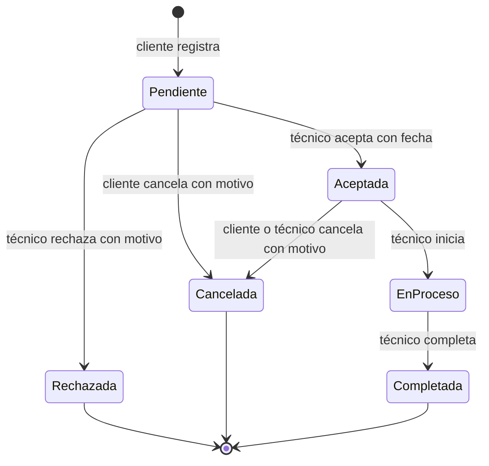

# GoFix · Especificación de requisitos de software
 
*Contrato funcional y de calidad de la primera versión. Incluye reglas, casos de uso, restricciones de datos, permisos y trazabilidad de aceptación.*
 
| Control documental | Definición |
|---|---|
| Código | GF-SRS-001 |
| Versión y estado | 1.0 · Revisión editorial 1 (reorganización sin cambio de reglas) · Línea base propuesta para revisión |
| Fecha | 19 de noviembre de 2026 |
| Producto | Plataforma web de conexión entre clientes y técnicos |
| Tecnología acordada | React + TypeScript · ASP.NET Core · SQL Server |
| Arquitectura acordada | Monolito modular · Clean Architecture pragmática |
| Principios acordados | SOLID · YAGNI · DRY |
 
> Las metas, límites y políticas identificados como propuestos requieren validación del responsable del producto. Este documento describe el diseño esperado y no acredita una implementación existente.
 
## 1. Introducción y convenciones
 
El SRS define el comportamiento esperado de GoFix para cliente, técnico y visitante. Todos los requisitos RF y RNF de esta línea base tienen prioridad obligatoria para la primera versión propuesta.
 
| Sigla | Significado |
|---|---|
| RF | Requisito funcional: una capacidad del sistema. |
| RN | Regla de negocio: una regla transversal. |
| RNF | Requisito no funcional: una condición de calidad. |
| CU | Caso de uso. |
 
Los criterios describen evidencias de aceptación y deberán convertirse en pruebas durante la implementación. Las decisiones técnicas expresamente acordadas son React, SQL Server y backend .NET como monolito modular con Clean Architecture pragmática, SOLID, YAGNI y DRY. Las políticas y umbrales numéricos se proponen para hacer verificable el alcance y requieren aprobación de producto. El documento no acredita pruebas ejecutadas.
 
### 1.1 Entorno, actores y dependencias
 
- **Actores.** El visitante accede al directorio. El cliente crea y gestiona solicitudes propias. El técnico administra su perfil y atiende solicitudes asignadas. La operación mantiene catálogos mediante un procedimiento controlado.
- **Dependencias.** Navegador, conectividad, API disponible y SQL Server.
- **Coordinación económica.** La coordinación económica y cualquier ajuste adicional de visita ocurren mediante contacto directo tras la aceptación.
- **Alcance inicial.** Un municipio de piloto, catálogos precargados y formularios en español. El alcance funcional se detalla en Especificaciones 1.0.
### 1.2 Reservado para evolución
 
Pagos, mensajería, avisos externos, fotografías, mapas, recuperación de contraseña por correo y verificación profesional. Si el piloto requiere autoservicio de recuperación, deberá incorporarse un proveedor y un flujo verificable antes de abrir el servicio al público.
 
## 2. Requisitos funcionales
 
Los requisitos se agrupan por módulo. Todos tienen prioridad obligatoria.
 
### 2.1 Identidad y cuenta
 
| ID | Requisito | Criterios de aceptación | CU |
|---|---|---|---|
| RF-01 | **Registro por rol.** Registra nombre, correo, teléfono, contraseña y rol cliente o técnico. | Un correo duplicado produce error de validación. Una cuenta técnica crea su perfil en la misma transacción. El rol solicitado fuera de la lista se rechaza. | CU-01 |
| RF-02 | **Sesión.** Permite acceso con correo y contraseña, consultar la sesión actual y cerrarla. | Credenciales incorrectas muestran un mensaje genérico. Al salir, el acceso protegido devuelve 401. | CU-02 |
| RF-03 | **Mi cuenta.** Permite al titular editar nombre y teléfono. | Un usuario distinto no puede modificar el registro. Correo y rol permanecen fuera del formulario de edición de esta versión. | CU-03 |
 
### 2.2 Profesionales, catálogos y búsqueda
 
| ID | Requisito | Criterios de aceptación | CU |
|---|---|---|---|
| RF-04 | **Perfil profesional.** Permite al técnico editar descripción, especialidades y sectores. | Se exige al menos una especialidad y un sector válidos para publicar el perfil. Una edición inválida conserva la versión anterior. | CU-03 |
| RF-05 | **Catálogos.** Entrega especialidades y sectores activos con su municipio. | Los catálogos precargados se consultan públicamente. La interfaz permite elegir identificadores existentes. | CU-03 |
| RF-06 | **Búsqueda.** Filtra técnicos publicados por especialidad y sector combinados. | Todos los resultados cumplen los filtros. Los perfiles incompletos quedan fuera. Se devuelve total y paginación estable por nombre e identificador. | CU-04 |
| RF-07 | **Detalle público.** Muestra nombre, descripción, especialidades, sectores, promedio y cantidad de opiniones. | Sin opiniones se muestra «Sin valoraciones». La respuesta pública excluye correo, teléfono y dirección. | CU-04 |
 
### 2.3 Solicitudes
 
| ID | Requisito | Criterios de aceptación | CU |
|---|---|---|---|
| RF-08 | **Crear solicitud.** Permite al cliente solicitar un técnico por una especialidad y sector atendidos. | Se crea en Pendiente con cliente obtenido de la sesión. Perfil, catálogo o cobertura inválidos impiden guardar. | CU-05 |
| RF-09 | **Consultar solicitudes.** Lista y detalla solicitudes propias del cliente o asignadas al técnico. | Filtros por estado y paginación funcionan. Un identificador ajeno devuelve 404 y no expone datos. | CU-06 |
| RF-10 | **Editar pendiente.** Permite al cliente modificar título, descripción, dirección, sector y fecha preferida mientras esté pendiente. | Se revalida cobertura. Cambiar técnico o especialidad requiere crear otra solicitud. Un estado distinto devuelve conflicto. | CU-07 |
| RF-11 | **Eliminar pendiente.** Permite al cliente eliminar una solicitud pendiente con confirmación. | Se aplica borrado lógico y desaparece de las consultas operativas de ambos participantes. Se conserva un evento técnico de eliminación. | CU-07 |
| RF-24 | **Reintento de creación.** Reconoce reenvíos de la misma creación de solicitud. | Una clave de idempotencia del mismo cliente y contenido devuelve el mismo resultado. Reutilizarla con contenido distinto produce 409. | CU-05 |
 
### 2.4 Seguimiento del servicio
 
| ID | Requisito | Criterios de aceptación | CU |
|---|---|---|---|
| RF-12 | **Aceptar solicitud.** Permite al técnico asignado aceptar una solicitud pendiente y confirmar fecha. | Fecha futura obligatoria. Estado, fecha e historial se guardan juntos. Solo una actualización concurrente tiene éxito. | CU-08 |
| RF-13 | **Rechazar solicitud.** Permite al técnico rechazar una solicitud pendiente indicando motivo. | Se registra Rechazada, motivo, actor y fecha. El estado es terminal. | CU-08 |
| RF-14 | **Cancelar solicitud.** Permite cancelación pendiente por el cliente y aceptada por cualquiera de los participantes. | Motivo obligatorio. Cancelar desde EnProceso o un estado terminal devuelve conflicto. | CU-09 |
| RF-15 | **Iniciar servicio.** Permite al técnico asignado pasar de Aceptada a EnProceso. | Se registra fecha real de inicio e historial. Se permite inicio anticipado si ambos lo han coordinado fuera de la plataforma. | CU-10 |
| RF-16 | **Completar servicio.** Permite al técnico pasar de EnProceso a Completada. | Se registra fecha de fin y observación opcional, habilitando la valoración al cliente. | CU-10 |
| RF-17 | **Historial.** Muestra creación, edición y transiciones a los participantes autorizados. | Entradas ordenadas por fecha e identificador, con el actor identificado y sin acciones de edición o borrado en la interfaz. | CU-06 |
| RF-18 | **Contacto privado.** Revela nombre y teléfono de la contraparte tras la aceptación. | En Aceptada, EnProceso, Completada y Cancelada tras aceptación, los participantes pueden consultarlos. Pendientes y rechazadas mantienen los teléfonos ocultos. | CU-06 |
| RF-21 | **Panel técnico.** Muestra pendientes, próximas visitas aceptadas y servicios en proceso del técnico. | Los conteos coinciden con los filtros de sus listados y excluyen solicitudes eliminadas. | CU-06 |
| RF-23 | **Control de versiones.** Rechaza ediciones, borrados y transiciones basados en una versión desactualizada. | Se devuelve 409 y la interfaz solicita recargar. La respuesta fallida no crea historial de éxito. | CU-07 a CU-10 |
 
### 2.5 Valoraciones
 
| ID | Requisito | Criterios de aceptación | CU |
|---|---|---|---|
| RF-19 | **Valorar servicio.** Permite al cliente una puntuación entera de 1 a 5 y comentario opcional para un servicio completado. | El cliente debe ser el titular. La base impide dos valoraciones para la misma solicitud. La opinión queda inmutable en esta versión. | CU-11 |
| RF-20 | **Reputación.** Muestra opiniones paginadas, promedio de una cifra decimal y cantidad. | Se calcula con valoraciones persistidas. Se muestra nombre de pila del cliente, puntuación, comentario y fecha, sin datos de contacto. | CU-04 |
 
### 2.6 Transversal
 
| ID | Requisito | Criterios de aceptación | CU |
|---|---|---|---|
| RF-22 | **Recuperación de interfaz.** Muestra carga, vacío, validación, error y sesión vencida. | Un fallo recuperable conserva el formulario. Una sesión vencida lleva al acceso sin guardar credenciales en el navegador. | Transversal |
 
## 3. Reglas de negocio
 
| ID | Regla |
|---|---|
| RN-01 | Una cuenta tiene un rol público único. El servidor deriva la identidad de la sesión y restringe acciones por rol y propiedad. |
| RN-02 | Un perfil se publica cuando tiene descripción de 50 a 1.000 caracteres, al menos una especialidad y un sector activos. |
| RN-03 | La solicitud debe dirigirse a un técnico publicado que atienda la especialidad y el sector elegidos al momento de crear o editar. |
| RN-04 | Editar solo modifica solicitudes pendientes del cliente. El borrado pendiente es lógico. Los registros posteriores a aceptación permanecen trazables. |
| RN-05 | Solo se permiten las transiciones indicadas en la matriz de estados. Rechazada, Cancelada y Completada son terminales. |
| RN-06 | Aceptar requiere fecha confirmada futura. La fecha preferida orienta al técnico y no constituye una reserva de agenda. |
| RN-07 | Cancelar o rechazar exige un motivo de 10 a 500 caracteres. Iniciar y completar corresponden al técnico asignado. |
| RN-08 | Una valoración pertenece a una solicitud completada y a su cliente. La restricción única por solicitud se aplica también en la base. |
| RN-09 | La edición de un perfil no modifica las solicitudes históricas. El técnico sigue obligado a gestionar sus solicitudes existentes. |
| RN-10 | Las fechas de eventos se guardan en UTC. Las citas usan DateTimeOffset y se muestran en America/Santo_Domingo. La API conserva el instante y su desplazamiento. |
| RN-11 | Ninguna acción pública expone correo, teléfono o dirección privada. La dirección se entrega al técnico asignado para evaluar la visita. |
| RN-12 | Estado, metadatos de transición e historial se confirman de forma atómica. Un conflicto mantiene la última versión confirmada. |
 
## 4. Permisos y estados
 
### 4.1 Matriz de autorización
 
| Operación | Visitante | Cliente | Técnico |
|---|---|---|---|
| Buscar y ver perfil | Sí | Sí | Sí |
| Editar cuenta | No | Propia | Propia |
| Editar perfil profesional | No | No | Propio |
| Crear solicitud | No | Sí | No |
| Ver solicitud | No | Propia | Asignada |
| Editar / eliminar pendiente | No | Propia | No |
| Aceptar / rechazar | No | No | Asignada pendiente |
| Cancelar | No | Propia pendiente o aceptada | Asignada aceptada |
| Iniciar / completar | No | No | Asignada según estado |
| Valorar | No | Propia completada | No |
 
### 4.2 Matriz de estados
 
<!-- fig:estados -->

 
| Origen | Acción y actor | Destino |
|---|---|---|
| Creación | Cliente registra | Pendiente |
| Pendiente | Técnico acepta con fecha | Aceptada |
| Pendiente | Técnico rechaza con motivo | Rechazada |
| Pendiente | Cliente cancela con motivo | Cancelada |
| Aceptada | Cliente o técnico cancela con motivo | Cancelada |
| Aceptada | Técnico inicia | EnProceso |
| EnProceso | Técnico completa | Completada |
 
La eliminación lógica afecta visibilidad y no constituye un nuevo estado de servicio. No se reabren estados terminales. Se permite editar o eliminar una solicitud pendiente aunque haya vencido la fecha preferida, pero una nueva fecha elegida debe ser futura. Al aceptar se verifica la fecha confirmada frente al reloj del servidor.
 
## 5. Datos y validaciones de entrada
 
| Dato | Restricción propuesta |
|---|---|
| Cuenta | Nombre de 2 a 100 caracteres. Correo hasta 254, normalizado y único. Teléfono de 10 a 15 dígitos, admitiendo prefijo +. Contraseña de 12 a 128 caracteres, con letras y números, procesada por Identity. |
| Perfil | Descripción de 50 a 1.000 caracteres. Especialidades y sectores activos, sin duplicados. El nombre público proviene de la cuenta. |
| Solicitud | Título de 10 a 120 caracteres. Descripción de 20 a 2.000. Dirección de 10 a 300. Especialidad, técnico y sector obligatorios. |
| Preferencia de visita | Fecha y hora futuras al crear o modificar la preferencia. El cliente puede describir flexibilidad en la descripción. |
| Transiciones | Versión obligatoria. Aceptación requiere fecha confirmada futura. Cancelación o rechazo exige motivo de 10 a 500 caracteres. Observación final opcional de hasta 1.000. |
| Valoración | Puntuación entera entre 1 y 5. Comentario opcional de hasta 1.000 caracteres. Una por solicitud. |
| Consulta | Página inicial 1, tamaño inicial 20, máximo 50. Filtro de estado limitado al catálogo de estados. Orden estable. |
 
Todos los textos se recortan en los extremos y se validan en el servidor. Los límites son parte del contrato y deben reflejarse en la interfaz y en el esquema. Se rechaza HTML como contenido enriquecido. Los comentarios se muestran como texto escapado. El correo no se incluye en respuestas públicas.
 
## 6. Casos de uso
 
### CU-01 · Registrar cuenta
 
- **Actor.** Visitante.
- **Precondición.** Correo disponible y catálogo accesible si el rol es técnico.
- **Flujo principal.** 1. Selecciona cliente o técnico. 2. Introduce datos. 3. El servidor valida rol, correo y contraseña. 4. Crea usuario, rol y perfil técnico si procede. 5. Confirma y dirige al inicio de sesión.
- **Alternativas y fallos.** Correo repetido o datos inválidos devuelven errores de campo. Si falla la creación del perfil, se revierte toda la operación.
- **Postcondición.** Cuenta creada sin sesión automática.
- **Requisitos.** RF-01.
### CU-02 · Acceder y cerrar sesión
 
- **Actor.** Cliente o técnico.
- **Precondición.** Cuenta registrada y habilitada.
- **Flujo principal.** 1. Introduce credenciales. 2. El servidor autentica. 3. Emite cookie y devuelve perfil básico. 4. La web abre el área del rol. 5. Al salir, invalida la sesión actual.
- **Alternativas y fallos.** Credenciales incorrectas producen mensaje genérico. El bloqueo temporal informa que se debe intentar después. Una sesión vencida exige autenticación.
- **Postcondición.** Sesión establecida o cerrada.
- **Requisitos.** RF-02, RF-22.
### CU-03 · Mantener cuenta y perfil
 
- **Actor.** Cliente o técnico.
- **Precondición.** Sesión válida.
- **Flujo principal.** 1. Consulta sus datos. 2. Modifica nombre y teléfono. 3. Si es técnico, completa descripción, especialidades y sectores. 4. Guarda. 5. Un perfil completo queda publicado.
- **Alternativas y fallos.** Un catálogo inválido impide guardar. Un conflicto de versión exige recarga. Los cambios del perfil no alteran solicitudes anteriores.
- **Postcondición.** Datos persistidos y publicación calculada por completitud.
- **Requisitos.** RF-03 a RF-05.
### CU-04 · Buscar y consultar técnico
 
- **Actor.** Cualquier usuario.
- **Precondición.** Catálogos disponibles.
- **Flujo principal.** 1. Selecciona especialidad y sector. 2. Obtiene resultados paginados. 3. Abre un perfil. 4. Consulta opiniones y cobertura. 5. Si es cliente autenticado, puede solicitar servicio.
- **Alternativas y fallos.** Sin coincidencias se ofrece cambiar filtros. Un perfil inexistente o retirado devuelve 404. El visitante que desea solicitar debe acceder primero.
- **Postcondición.** Información pública presentada sin contactos privados.
- **Requisitos.** RF-06, RF-07, RF-20.
### CU-05 · Solicitar asistencia
 
- **Actor.** Cliente.
- **Precondición.** Sesión válida y técnico publicado.
- **Flujo principal.** 1. Elige especialidad y sector atendidos. 2. Describe problema, dirección y fecha preferida. 3. Confirma. 4. Envía con clave de idempotencia. 5. El servidor crea solicitud e historial y muestra el detalle.
- **Alternativas y fallos.** Una cobertura cambiada produce error sin creación. Un reenvío idéntico devuelve la solicitud original. Una clave repetida con contenido distinto produce conflicto.
- **Postcondición.** Solicitud pendiente y una sola creación por clave.
- **Requisitos.** RF-08, RF-24.
### CU-06 · Consultar seguimiento
 
- **Actor.** Cliente o técnico.
- **Precondición.** Relación como cliente o técnico de la solicitud.
- **Flujo principal.** 1. Abre su listado o panel. 2. Filtra por estado. 3. Consulta detalle e historial. 4. Ve fecha confirmada y contactos según estado.
- **Alternativas y fallos.** Un identificador ajeno devuelve 404. Si la solicitud se eliminó, deja de estar disponible. Un fallo de carga ofrece reintentar la consulta.
- **Postcondición.** Consulta sin modificación de datos.
- **Requisitos.** RF-09, RF-17, RF-18, RF-21.
### CU-07 · Modificar o eliminar pendiente
 
- **Actor.** Cliente.
- **Precondición.** Solicitud propia pendiente y versión vigente.
- **Flujo principal.** 1. Abre la solicitud. 2. Edita campos permitidos o pide eliminar. 3. Confirma. 4. El servidor verifica estado y versión. 5. Guarda la edición con evento, o marca la eliminación lógica.
- **Alternativas y fallos.** Si el técnico acaba de aceptarla, se devuelve 409. Un sector fuera de cobertura bloquea la edición. Cancelar el diálogo de eliminación conserva el registro.
- **Postcondición.** Solicitud actualizada o excluida de las consultas operativas.
- **Requisitos.** RF-10, RF-11, RF-23.
### CU-08 · Decidir sobre solicitud
 
- **Actor.** Técnico.
- **Precondición.** Solicitud asignada pendiente.
- **Flujo principal.** 1. Revisa problema y ubicación. 2. Elige aceptar o rechazar. 3. Confirma fecha futura o explica el motivo de rechazo. 4. El servidor verifica versión y guarda estado e historial.
- **Alternativas y fallos.** Una fecha pasada o un motivo corto producen validación. Si el cliente canceló o eliminó, responde conflicto o 404 según corresponda.
- **Postcondición.** Solicitud aceptada con fecha o rechazada con motivo.
- **Requisitos.** RF-12, RF-13, RF-23.
### CU-09 · Cancelar antes del inicio
 
- **Actor.** Cliente o técnico.
- **Precondición.** Cliente con pendiente propia, o participante de aceptada.
- **Flujo principal.** 1. Abre detalle. 2. Selecciona cancelar. 3. Explica el motivo. 4. Confirma. 5. El sistema cambia el estado e incorpora historial.
- **Alternativas y fallos.** Un trabajo ya iniciado o terminal impide la cancelación. Un conflicto concurrente devuelve 409. Una cancelación no representa un reembolso.
- **Postcondición.** Solicitud cancelada y conservada para consulta.
- **Requisitos.** RF-14, RF-23.
### CU-10 · Ejecutar y completar servicio
 
- **Actor.** Técnico.
- **Precondición.** Solicitud asignada aceptada para iniciar, o en proceso para completar.
- **Flujo principal.** 1. Abre detalle. 2. Inicia el trabajo. 3. El sistema registra la fecha real. 4. Al finalizar, el técnico completa con observación opcional. 5. El cliente obtiene acceso a valorar.
- **Alternativas y fallos.** Un estado inesperado produce conflicto. Un fallo de persistencia revierte estado e historial juntos.
- **Postcondición.** Servicio en proceso o completado con fechas y trazabilidad.
- **Requisitos.** RF-15, RF-16, RF-23.
### CU-11 · Valorar atención
 
- **Actor.** Cliente.
- **Precondición.** Solicitud propia completada y sin valoración.
- **Flujo principal.** 1. Abre el servicio. 2. Selecciona estrellas y comentario opcional. 3. Confirma. 4. El sistema valida elegibilidad y unicidad. 5. Publica la opinión y recalcula el promedio en consulta.
- **Alternativas y fallos.** Una puntuación fuera de rango produce validación. Un reenvío o segunda opinión devuelve 409 sin duplicados.
- **Postcondición.** Una valoración vinculada al servicio.
- **Requisitos.** RF-19, RF-20.
## 7. Requisitos no funcionales
 
| ID | Atributo | Condición exigida | Verificación |
|---|---|---|---|
| RNF-01 | Seguridad de sesión | HTTPS en despliegue, cookies HttpOnly y Secure, token antifalsificación en operaciones mutables y expiración absoluta propuesta de 60 minutos. | Pruebas con sesión vencida, petición sin token y cierre de sesión. Validar atributos de cookies. |
| RNF-02 | Autorización | Todos los endpoints protegidos verifican rol y pertenencia. La interfaz refleja permisos y la API los impone. | Matriz con dos clientes, dos técnicos y visitante. Intentar lectura y escritura cruzadas. |
| RNF-03 | Protección del acceso | Propuesta de bloqueo de 15 minutos tras cinco fallos consecutivos. Limitar login y registro a diez peticiones por minuto por IP, con 429. | Verificar umbrales configurados y recuperación del bloqueo. Evaluar redes compartidas en el piloto. |
| RNF-04 | Rendimiento | Meta propuesta p95 de API menor o igual a 800 ms en consultas y 1.200 ms en escrituras, excluyendo arranque y red externa. | Ensayo de 10 min con 20 usuarios concurrentes, 1.000 técnicos y 10.000 solicitudes. Registrar hardware y tasa de error menor de 1 %. |
| RNF-05 | Integridad y concurrencia | Transiciones atómicas, rowversion y unicidad de correo y valoración. Ningún éxito parcial visible. | Pruebas paralelas y fallo inyectado antes del commit sobre SQL Server real de prueba. |
| RNF-06 | Accesibilidad | Flujos principales utilizables con teclado, foco visible, etiquetas, errores asociados y contraste de texto normal de al menos 4,5 a 1. | Revisión automática y manual. Objetivo alineado con WCAG 2.2 AA, sin afirmar certificación. |
| RNF-07 | Adaptabilidad | Sin desplazamiento horizontal de página entre 360 y 1.440 px. Navegadores objetivo Chrome y Edge estables al aceptar la versión. | Probar registro, búsqueda y solicitud en 360, 768 y 1.440 px. Respetar movimiento reducido. |
| RNF-08 | Mantenibilidad | Domain independiente de frameworks y dependencias dirigidas hacia el núcleo. Cambios revisados con SOLID, YAGNI y DRY. | Inspección de referencias, compilación y pruebas de cada PR. Contratos HTTP documentados en OpenAPI. |
| RNF-09 | Recuperación | Objetivos propuestos del piloto: RPO de 24 h y RTO de 4 h, con respaldo diario y antes de migraciones. | Restaurar una copia en base aislada y registrar duración y validación funcional. Depende del entorno operativo. |
| RNF-10 | Observabilidad | Cada error de API devuelve identificador de correlación. Los logs estructurados excluyen contraseñas, cookies, direcciones y teléfonos. | Provocar 400, 409 y 500, correlacionar diagnóstico y revisar que no aparezcan datos sensibles. |
| RNF-11 | Reproducibilidad | Una copia limpia debe compilar y ejecutar migraciones siguiendo el README. Versiones y archivos de bloqueo en control de versiones. | Ejecutar instalación con SQL Server aislado, sin credenciales del autor. Migraciones ejecutadas por un responsable antes de iniciar la versión. |
| RNF-12 | Robustez de interfaz | Evitar doble envío y conservar datos ante fallos recuperables. Las mutaciones no se reintentan automáticamente salvo creación idempotente. | Simular pérdida de respuesta, timeout, doble clic y actualización concurrente. Verificar un único resultado persistido. |
 
## 8. Interfaces externas y comportamiento ante fallos
 
La interfaz es una SPA React en español. La API usa HTTPS, JSON UTF-8 y rutas `/api/v1`. El contrato OpenAPI recoge entradas, salidas y errores. En despliegue se propone un origen único para frontend y API. SQL Server solo es accesible al backend y a los procedimientos de operación autorizados.
 
| Resultado | Comportamiento esperado |
|---|---|
| 200 / 201 / 204 | Consulta o mutación exitosa. Crear devuelve identificador y ubicación del recurso. Eliminar o salir puede devolver 204. |
| 400 | Entrada inválida con errores de campo, sin cambio persistido. |
| 401 / 403 | Falta de sesión / rol incompatible. Un recurso ajeno se trata como 404 para reducir exposición. |
| 404 | Recurso inexistente, ajeno o eliminado. |
| 409 | Estado incompatible, versión desactualizada, clave idempotente incompatible o valoración duplicada. |
| 429 / 500 / 503 | Límite de solicitudes / fallo inesperado / dependencia temporalmente indisponible. Mostrar mensaje seguro e identificador de correlación. |
 
La web envía cookies y token antifalsificación. Los errores siguen Problem Details con código de aplicación y `traceId`. Los endpoints de API responden códigos HTTP y JSON, incluso ante sesión vencida. Una consulta fallida puede reintentarse. Tras una escritura con resultado incierto, se consulta el estado antes de repetir la operación.
 
## 9. Trazabilidad y plan de aceptación
 
### 9.1 Matriz de trazabilidad
 
La columna de rama es una **asignación propuesta** que enlaza este SRS con el plan de entrega de Especificaciones §8.
 
| Requisitos | Caso de uso y evidencia | Módulo | Rama (propuesta) |
|---|---|---|---|
| RF-01, RF-02 | CU-01 y CU-02. Registro atómico, acceso y salida. | Identidad | `feature/usuarios-perfiles` |
| RF-03 a RF-05 | CU-03. Edición y completitud del perfil. | Identidad / Profesionales | `feature/usuarios-perfiles` |
| RF-06, RF-07 | CU-04. Filtros y privacidad. | Profesionales | `feature/busqueda-tecnicos` |
| RF-08, RF-24 | CU-05. Alta e idempotencia con respuesta perdida. | Servicios | `feature/solicitudes-servicio` |
| RF-09, RF-10, RF-11 | CU-06 y CU-07. Propiedad y CRUD pendiente. | Servicios | `feature/solicitudes-servicio` |
| RF-12 a RF-16 | CU-08 a CU-10. Matriz completa de estados. | Servicios | `feature/seguimiento-servicios` |
| RF-17, RF-18, RF-21 | CU-06. Contacto, historial y panel. | Servicios | `feature/seguimiento-servicios` |
| RF-23 | CU-07 a CU-10. Carrera con aceptación. | Servicios | `feature/solicitudes-servicio` y `feature/seguimiento-servicios` |
| RF-19, RF-20 | CU-11 y CU-04. Elegibilidad, unicidad y reputación. | Valoraciones | `feature/valoraciones` |
| RF-22, RNF-01 a RNF-12 | Pruebas transversales de la sección 7. | Todos | Todas |
 
### 9.2 Criterios de aceptación
 
La aceptación requiere:
 
- Ejecutar los once casos de uso con datos de prueba.
- Cubrir todas las transiciones permitidas y rechazar las inválidas.
- Probar acceso cruzado y concurrencia sobre SQL Server.
- Registrar resultados de los RNF.
- Documentar impacto y decisión explícita del responsable para cada hallazgo pendiente.
La cobertura porcentual de código no sustituye estas evidencias.
 
### 9.3 Escenarios críticos de integración
 
- Aceptar y cancelar simultáneamente la misma solicitud debe producir un éxito y un conflicto, con un único estado final coherente.
- Dos envíos paralelos de valoración para el mismo servicio deben crear una sola opinión.
- Una excepción al insertar historial debe impedir que se confirme la transición.
- Un cliente que cambia el identificador de una URL debe recibir 404 al intentar consultar solicitudes ajenas.
- Reenviar una creación tras perder la respuesta debe devolver la misma solicitud si conserva clave y contenido.
## 10. Gestión de cambios, supuestos y glosario
 
**Cambios.** Todo cambio deberá identificar requisitos afectados, migraciones, contrato de API, pantallas, pruebas y efecto en las ramas ya integradas. El responsable del producto aprueba reglas y alcance. El responsable técnico valida viabilidad y coherencia. Se incrementa la versión de los tres documentos si cambia una regla compartida.
 
**Pendiente de validar.**
 
- Las políticas propuestas de la sección 9 de Especificaciones.
- La lista inicial de sectores y especialidades.
- El entorno de medición y los objetivos de recuperación.
- El alojamiento y la operación pública, que necesitan planificación posterior.
- La entrega académica, que se valida además contra su consigna, con repositorio accesible y PDF adjunto en la plataforma.
**Referencias.** Especificaciones y Arquitectura GoFix 1.0. Las fuentes técnicas se listan en Arquitectura.
 
| Término | Significado |
|---|---|
| CRUD | Crear, consultar, actualizar y eliminar. |
| API | Interfaz HTTP. |
| UTC | Referencia temporal. |
| RPO | Pérdida máxima de datos objetivo. |
| RTO | Tiempo objetivo de recuperación. |
 
## Anexo A. Revisión de arquitectura
 
### A.1 Cambios de organización
 
- Los requisitos funcionales se agruparon por módulo (2.1 a 2.6) y se presentan como tablas con criterio de aceptación y caso de uso.
- Las reglas de negocio pasaron a una tabla (3). Los permisos y estados se unieron en una sola sección (4), con un diagrama de estados.
- Los casos de uso conservan su estructura con campos fijos (6). Los RNF son una tabla (7).
- La trazabilidad se amplió con módulo y rama propuesta (9.1). Los escenarios críticos se mantuvieron.
- La referencia a «sección 8 de Especificaciones» se actualizó a la sección 9 por la nueva numeración.
- No se modificó ninguna regla, límite ni decisión.
### A.2 Observaciones
 
Las observaciones **no cambian la línea base**. Requieren aprobación del responsable del producto según Especificaciones 1.2.
 
| ID | Prioridad | Observación | Recomendación |
|---|---|---|---|
| SRS-H1 | Media | RF-04 exige al menos una especialidad y un sector para publicar, pero RN-02 exige además una descripción de 50 a 1.000 caracteres. | Alinear el criterio de RF-04 con RN-02 para que la prueba de aceptación cubra las tres condiciones. |
| SRS-H2 | Baja | RF-18 menciona «Cancelada tras aceptación», pero el estado final no distingue por sí mismo cuándo se canceló. La Arquitectura guarda la fecha de aceptación. | Redactar la regla de visibilidad en términos de ese dato: el contacto es visible si la solicitud tiene fecha de aceptación y no está eliminada. |
| SRS-H3 | Media | RF-23 aparece en los casos CU-07 a CU-10, que se reparten en dos ramas (3 y 4). | Implementar el mecanismo de versión (rowversion) en la rama 3 y reutilizarlo en la 4, con la prueba de carrera en la rama 4. |
 